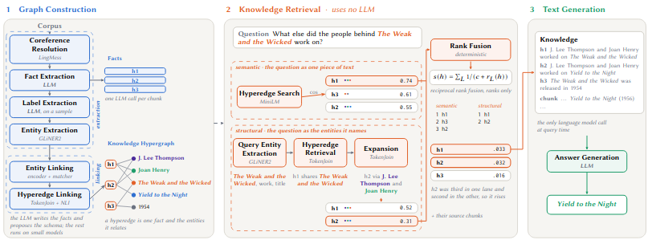

# Nexus

Nexus builds a knowledge hypergraph from a corpus and answers questions over it.
One idea organises the design: a fact is a short piece of text that states one
thing and stands on its own, and the entities named in a fact are the entities it
relates, so a fact and its entities are already a hyperedge and no separate stage
has to read a passage and decide which entities belong together. An LLM runs in
only three steps of the whole system, writing the facts, proposing the label
schema from a small sample of them and writing the final answer; everything else
runs on small local models, and retrieval makes no LLM call at all.



## Setup

```
pip install -r requirements.txt
python -m spacy download en_core_web_sm
```

The coreference step loads LingMess from HuggingFace on first use, about 1.5GB,
with no progress output of its own.

Every step that calls a model reads three environment variables:

```
export NEXUS_LLM_BASE_URL=https://api.openai.com/v1
export NEXUS_LLM_API_KEY=sk-...
export NEXUS_LLM_MODEL=gpt-4o-mini
```

The key is never read from a file or passed on the command line.

## Data

The five KHQA domains are in `datasets/`, one directory per domain holding
`texts.json`, `questions_512.json` and `questions_200.json`. Nothing has to be
downloaded.

## Measuring cost

`gateway.py` is a logging proxy. It forwards every call to OpenAI untouched and
appends one JSON line per call recording the stage, the model and the token
counts, which is where every efficiency number in the paper comes from. Point a
client at it instead of at OpenAI and the run is measured without changing the
client.

```
cd evaluation/
uvicorn gateway:app --port 8121
```

It writes `logs_<port>.jsonl` in the working directory, which is where
`compare.py` looks by default. `UPSTREAM` overrides the target (default
`https://api.openai.com`) and `LOG_PREFIX` the filename.

Clients address it as `http://localhost:<port>/<method>_<dataset>/<stage>/v1`,
for example `http://localhost:8121/Nexus_Mix/construct/v1`. The run scripts set
this themselves, so with the gateways up there is nothing else to configure. To
run without measurement, point `NEXUS_LLM_BASE_URL` at OpenAI directly.

## Reproducing

### Nexus

```
cd source/graph_construction/
./run_graph_construction.sh

cd ../knowledge_retrieval/
./run_semantic.sh
./run_structured.sh
./run_fusion.sh
```

Construction runs once per corpus and writes the hypergraph to
`output/graphs/Nexus/<dataset>/`. The three retrieval scripts share that graph
and produce Nexus-Sem, Nexus-Str and Nexus-Hyb. `run_fusion.sh` reads the output
of the other two, so it runs last.

### Baselines

```
cd sota/baselines/
./run_all.sh
```

Golden, StandardRAG and PlainLLM: the ceiling, the no-graph reference point and
the closed-book floor.

### Compared systems

The three hypergraph systems ([HyperGraphRAG](https://github.com/LHRLAB/HyperGraphRAG),
[HyperRAG](https://github.com/Vincent-Lien/HyperRAG),
[PRoH](https://github.com/zaixjun/PRoH)) are run from their own repositories, with the
corpora in `datasets/` and `NEXUS_LLM_BASE_URL` pointed at a gateway port so
their calls are logged the same way.

HyperRAG queries the graph HyperGraphRAG builds, so run HyperGraphRAG first.

## Evaluation

### Efficiency

```
cd evaluation/
python compare.py complete --stage construct --per-call --graph-stats
python compare.py complete --stage retrieve_512 --per-question
python compare.py complete --stage retrieve_200 --per-question
python compare.py complete --stage generate_512 --per-question
python compare.py complete --stage generate_200 --per-question
```

Construction cost and graph size, then retrieval and generation cost per
question on each of the two question sets.

### Effectiveness

```
cd evaluation/
./run_score_knowledge.sh
./run_score_answers.sh
```

`run_score_knowledge.sh` scores what retrieval returned against the golden
fragments. `run_score_answers.sh` scores the answers, and calls the judge for
Answer Equivalence on the two methods the paper reports it for.

### Cost against quality

```
cd evaluation/
python total_cost.py --tex --plot cost.png
```

Reads the scores written above and the gateway logs, and reports the whole bill
for each dataset against the quality it bought. `--metric AE` switches the
quality axis from F1 to Answer Equivalence.
